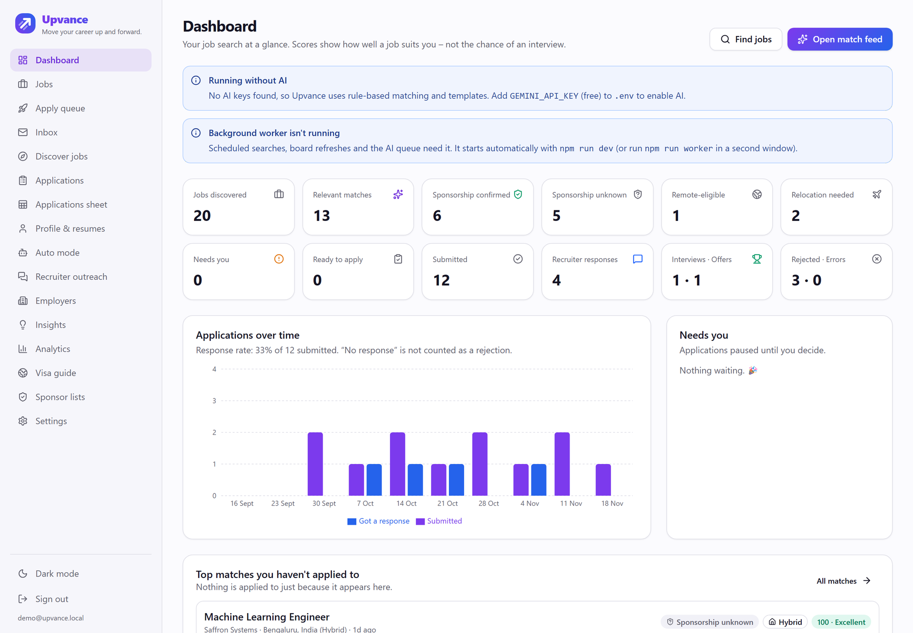
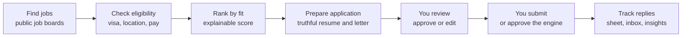
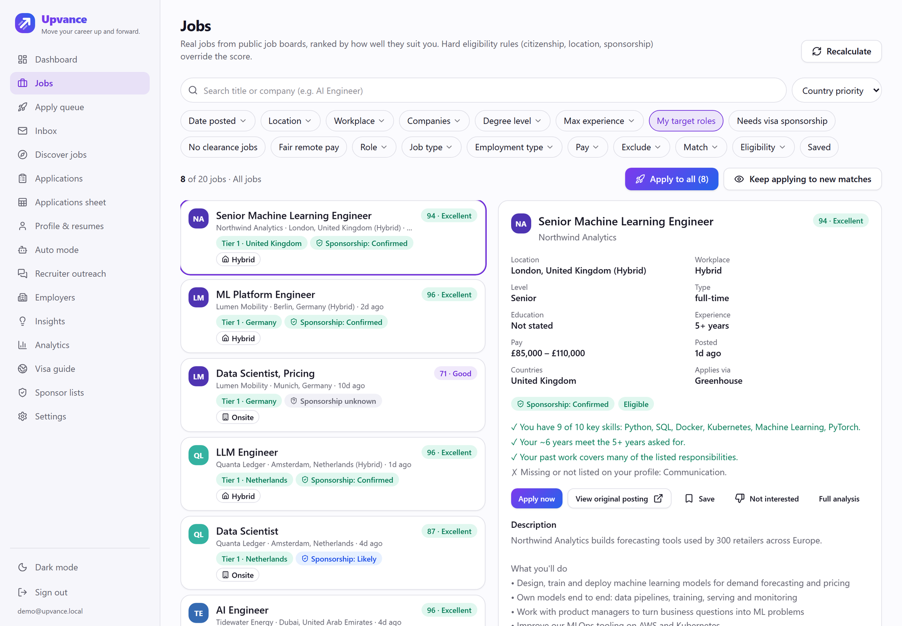
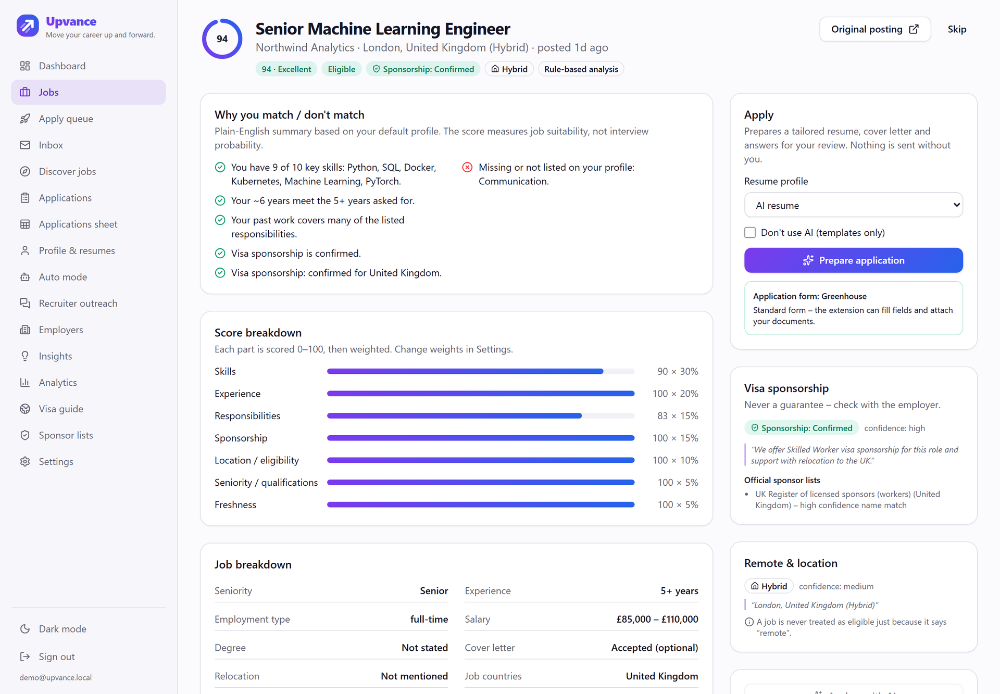
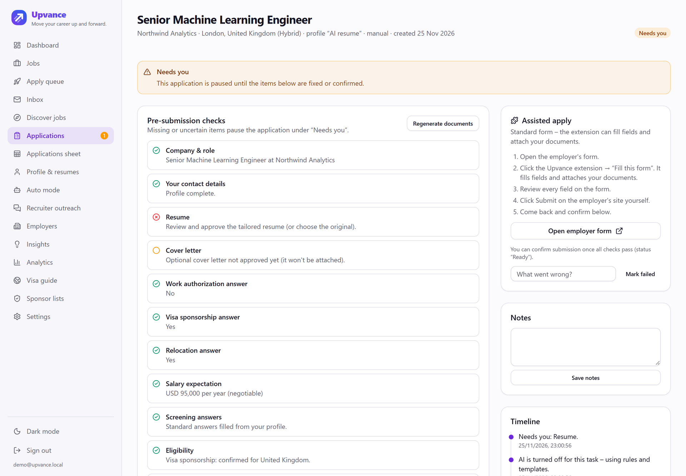
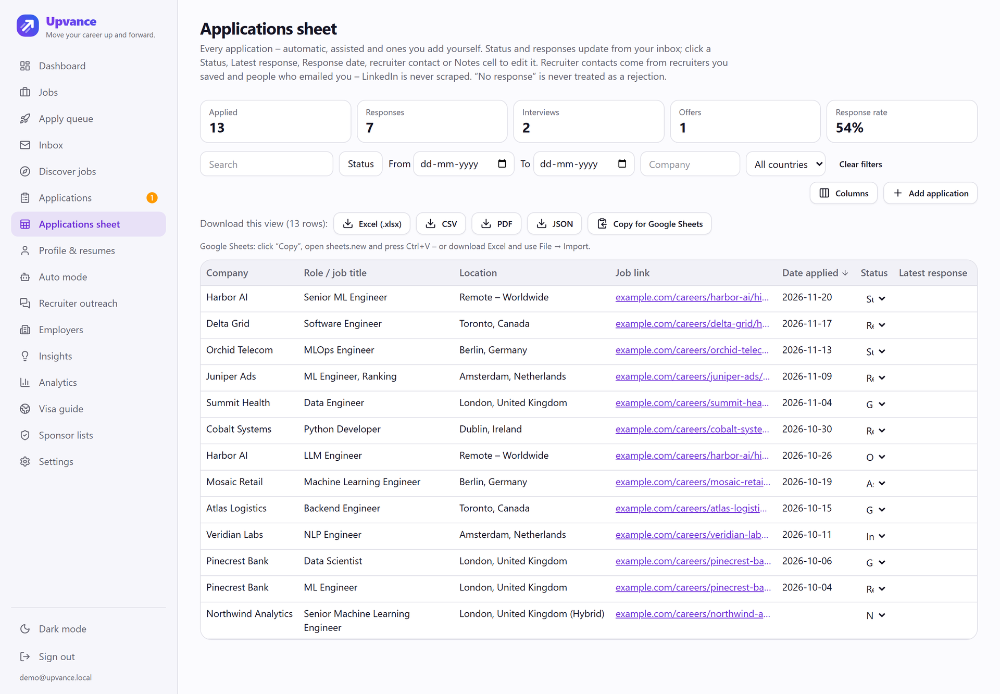
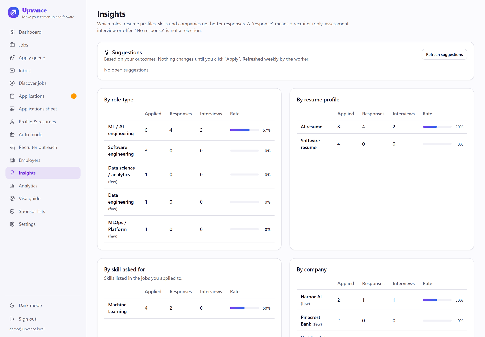
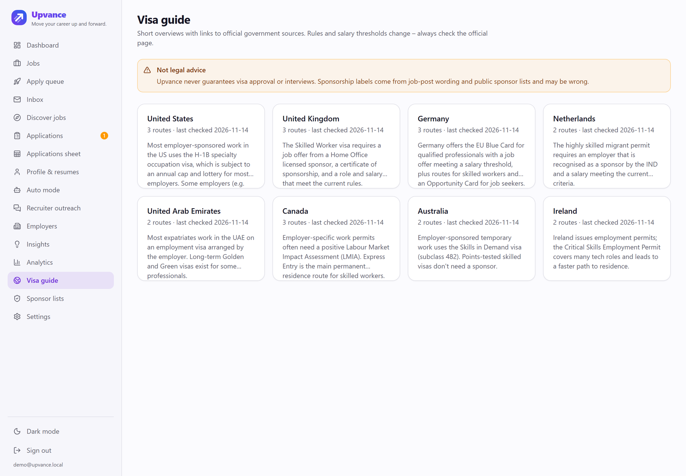
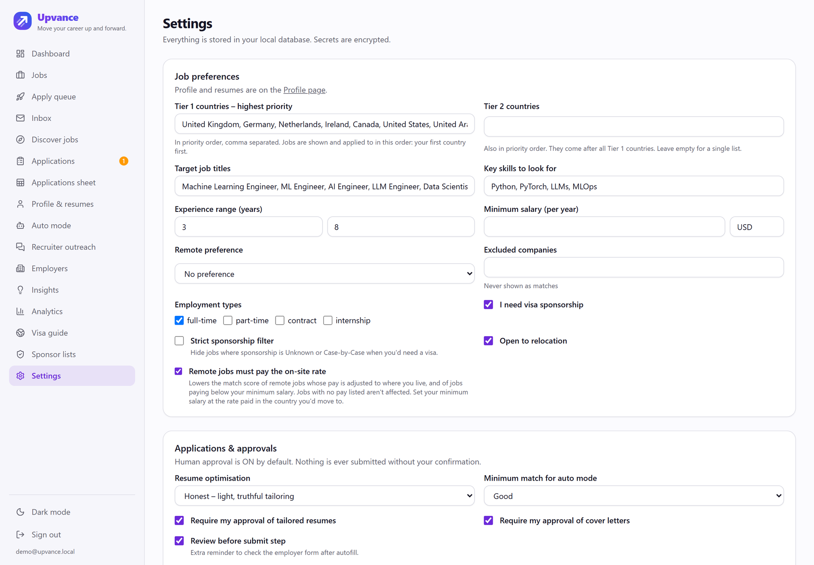

# Upvance

**Move your career up and forward.**

A job-search and application assistant for people who want to work abroad. It finds real jobs, checks visa sponsorship and location eligibility honestly, ranks jobs by how well they suit you, prepares truthful applications, and leaves **you** in control of every submission. Everything runs on your own computer.

> **License: [PolyForm Strict 1.0.0](https://polyformproject.org/licenses/strict/1.0.0) (source-available).** The code is published so you can read it and try it for non-commercial purposes. You may not use it commercially or sell it, change it, or share copies of it. It is not open source. See [LICENSE](LICENSE).

## The problem

Searching for a job in another country is slow and risky:

- Thousands of listings are spread across many job boards.
- It is often unclear whether an employer will sponsor a visa, and wrong guesses waste weeks.
- Tailoring a resume and cover letter for every role takes hours, and AI tools can invent experience that you then have to defend in an interview.
- Tracking dozens of applications, replies and follow-ups turns into a spreadsheet job of its own.

## What Upvance does

- **Find** real jobs from public job-board APIs (Greenhouse, Lever, Ashby, Workable, SmartRecruiters, Workday and more) plus Remotive, Remote OK, Arbeitnow and Adzuna. Company discovery covers about 167,000 sponsor-listed employers.
- **Check** sponsorship from quoted job-post wording and official sponsor lists (UK register, USCIS H-1B, Netherlands IND, Canada LMIA). Hard rules such as citizenship, location and "no sponsorship" override the score.
- **Rank** every job with a weighted, explainable score, so you can see why a job does or does not fit.
- **Prepare** a tailored resume, cover letter and screening answers. A fabrication guard reverts any edit that invents experience, and every change is listed beside your original.
- **Apply** with a visible browser that fills the form and stops for your review, or with the Chrome extension. Nothing is submitted without your confirmation.
- **Track** everything in an applications sheet (export to Excel, CSV, PDF or JSON), an inbox that updates statuses, recruiter outreach drafts, and insights on which roles and resumes get responses.

## Screenshots

> All screenshots use **fictional sample data**: a made-up candidate, made-up companies and `example.com` links.

| Match feed | Job analysis |
| --- | --- |
|  |  |

| Application review | Applications sheet |
| --- | --- |
|  |  |

| Insights | Visa guide |
| --- | --- |
|  |  |

## Built to be trusted

Upvance handles career decisions, so it is strict about what it will not do:

- It **never submits an application without your confirmation**. Human approval is on by default.
- It **never invents experience**. AI edits are checked against your real profile and reverted if they add facts.
- It **never logs into LinkedIn, scrapes it, or bypasses CAPTCHAs**. Those steps are handed back to you.
- It **never promises visa approval or interviews**, and says so on the pages where it matters.
- Your data stays in a **local database on your computer**, and saved passwords and keys are encrypted.
- It works with **no AI keys at all**, using rule-based matching and editable templates.

## Engineering at a glance

- **Full-stack TypeScript**: Next.js 16 (App Router) and React 19 with server actions, Prisma and SQLite (PostgreSQL-ready), NextAuth v5, Tailwind CSS 4, Zod validation.
- **Provider-agnostic AI layer**: Gemini, Groq, OpenRouter, Anthropic or none, with fallback between providers, caching so the same job is never analysed twice, retries with backoff and per-provider daily limits.
- **Matching engine**: rule-based analysis plus optional AI, a weighted score with a visible breakdown, and eligibility rules that override it.
- **Apply engine**: Playwright driving a visible Chromium browser, with a dry-run mode. Its automated tests run against local mock employer forms and never submit a real application.
- **Background worker**: scheduled searches, job-board refreshes, sponsor-list imports and the AI queue.
- **Chrome extension** (Manifest V3) paired to the local app by a token, acting only when you click it.
- **Quality**: **129 passing automated tests** and a clean strict type check.

| Layer | Tech |
| --- | --- |
| App | Next.js 16 · React 19 · TypeScript · Tailwind CSS 4 · Recharts |
| Data | Prisma · SQLite · Zod |
| Automation | Playwright · Chrome extension (MV3) · node-cron |
| AI | Gemini · Groq · OpenRouter · Anthropic (optional) |
| Documents and mail | pdf-lib · docx · exceljs · unpdf · imapflow · nodemailer |
| Tests | Vitest, including the apply engine against mock employer forms |

## Status

The core application is complete and tested, and I am still polishing it. Evaluators who want to run it on their own computer can follow the [setup and user guide](docs/USER-GUIDE.md).

## About

Designed and built by **Dega Mihir Kumar** — [github.com/DegaMihir](https://github.com/DegaMihir)

## License

[PolyForm Strict License 1.0.0](https://polyformproject.org/licenses/strict/1.0.0). Copyright (c) 2026 Dega Mihir Kumar. Non-commercial use only; no changes and no distribution. See [LICENSE](LICENSE). For permission to use it commercially, contact me through my GitHub profile.
